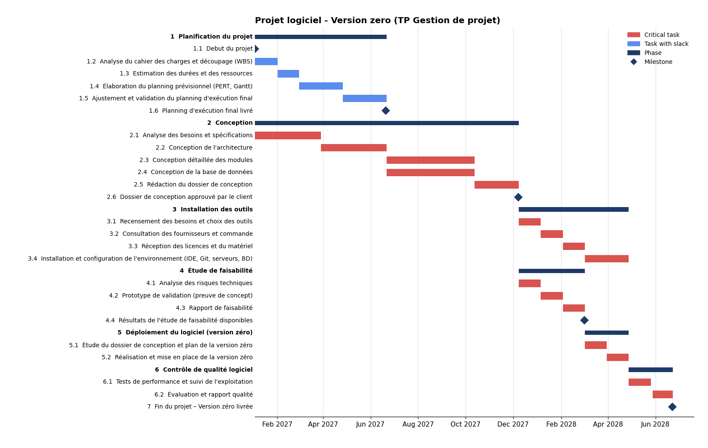

# 📅 Software Project Planning — Microsoft Project

Full schedule of a software project ("version zero") built in Microsoft Project for the Project Management course of my Master's in Software Engineering at USTHB. It covers the work breakdown structure, durations, dependencies, resources, milestones and the critical path.

The plan itself is in French.

## 📊 Gantt Chart

Red tasks are on the critical path. Blue tasks have slack. The chart was generated from the data in the `.mpp` file.

## 🗂️ Overview

| | |
|---|---|
| **Duration** | 380 working days, from 3 January 2027 to 22 June 2028 |
| **Workload** | 1,040 person-days |
| **Structure** | 6 phases, 25 tasks and milestones |
| **Resources** | 6 teams |
| **Calendar** | Algerian working week, Sunday to Thursday |

## 🧱 Work Breakdown Structure

| Phase | Duration | Dates | Team |
|-------|----------|-------|------|
| 1. Project planning | 120 days | Jan 2027 – Jun 2027 | Planning |
| 2. Design | 240 days | Jan 2027 – Dec 2027 | Engineering office |
| 3. Tools setup | 100 days | Dec 2027 – Apr 2028 | Purchasing |
| 4. Feasibility study | 60 days | Dec 2027 – Mar 2028 | Quality |
| 5. Software deployment (version zero) | 40 days | Mar 2028 – Apr 2028 | Logistics |
| 6. Software quality control | 40 days | Apr 2028 – Jun 2028 | Quality, Methods |

**Milestones:** project start, final execution schedule delivered, design file approved by the client, feasibility results available, and version zero delivered.

## 🔗 Dependencies and Critical Path

- Design runs from requirements to architecture, then detailed module design and database design in parallel, and finally the design file.
- Once the design file is approved, tools setup starts, and the feasibility study starts at the same time (start-to-start link).
- Deployment waits for both the approved design file and the feasibility results.
- Quality control starts when the environment is installed and version zero is in place.
- **Critical path:** Design → Tools setup and Feasibility study → Deployment → Quality control → Delivery.
- **Project planning** is not on the critical path: it has 260 days of slack, because it runs alongside the design phase.

## 🚀 How to Open

Open `projet-logiciel-version-zero.mpp` with **Microsoft Project**. Without it, you can view the file with free viewers such as ProjectLibre.

## 👤 Author

**Adel Merad** — [GitHub](https://github.com/adelmerad)
